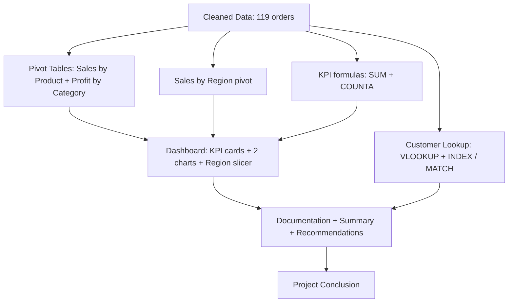

<div align="center">

# 📊 Sales Dashboard Project

### Excel Main Project

**Data Cleaning · Pivot Tables · Dashboard · Slicer · Lookup Formulas**

Created by **✨ Vaidehi Vyas ✨**


*💬 Raw sales rows only become a business story once they are cleaned, summarized, and put on one screen.*

</div>

<br>

<div align="center">

| 📁 11 | 🧾 119 | 💰 34,67,954.50 | 💹 7,06,719.50 | 📈 2 |
|:-:|:-:|:-:|:-:|:-:|
| **Worksheets** | **Orders** | **Total sales** | **Total profit** | **Dashboard charts** |

</div>

### ⚡ At a Glance

| 🏆 Top Region | 🛒 Top Category | 💻 Top Product | 👑 Top Customer | 💳 Top Payment |
|:-:|:-:|:-:|:-:|:-:|
| **Surat**<br>23.8% | **Electronics**<br>78.2% | **Laptop**<br>66.2% | **Pari Desai**<br>4,07,731 | **UPI**<br>29.8% |

---

## Table of Contents

1. [📌 Overview](#overview)
2. [🎯 Problem Statement](#problem-statement)
3. [✨ Key Features](#key-features)
4. [🗂️ Project Structure](#project-structure)
5. [🔄 Project Workflow](#project-workflow)
6. [🧹 Part A — Cleaned Data](#part-a--cleaned-data)
7. [🧮 Part B — Pivot Tables & Sales Analysis](#part-b--pivot-tables--sales-analysis)
8. [📊 Part C — Dashboard: KPIs, Charts & Slicer](#part-c--dashboard-kpis-charts--slicer)
9. [🔎 Part D — Formula Practice: Customer Lookup](#part-d--formula-practice-customer-lookup)
10. [📝 Part E — Report & Documentation Sheets](#part-e--report--documentation-sheets)
11. [🛠️ Tech Stack](#tech-stack)
12. [💡 Results & Insights](#results--insights)
13. [🐞 Known Quirks & Fixes](#known-quirks--fixes)
14. [🚀 Advantages](#advantages)
15. [📜 License](#license)
16. [👩‍💻 Author](#author)
17. [🙏 Acknowledgements](#acknowledgements)

---

## Overview

**Sales Dashboard Project** is a hands-on **Microsoft Excel** workbook (`main_project.xlsx`) built around one idea: a cleaned sales table becomes useful once it can **summarize itself, show where the money and profit come from, and let a viewer filter it with one click**. Across eleven worksheets, the workbook takes 119 cleaned sales orders and turns them into KPI cards, pivot tables, charts, a Region slicer, and lookup formulas.

> [!TIP]
> New here? Start with the **Dashboard** sheet for the big picture, then open **Pivot Tables** and **Sales by Region** to see where the numbers come from.

This project is designed to:

- Clean a raw sales dataset into a single **Cleaned Data** sheet with 15 columns
- Calculate **KPIs** such as total sales, total profit, and total orders
- Summarize sales by **product** and **region**, and profit by **category**, using **PivotTables**
- Build a **Dashboard** with KPI cards, two charts, and an interactive **Region slicer**
- Highlight profit values with a **colour-scale** conditional format
- Practise **`VLOOKUP`**, **`INDEX` + `MATCH`**, and **`IF`** on a customer lookup sheet
- Provide report sheets for documentation, summary, analysis, recommendations, and conclusion

---

## Problem Statement

> **Objective:** Given a list of sales orders — customers, regions, products, categories, quantities, prices, discounts, costs, payment methods, and salespeople — use Excel's built-in tools to clean the data, analyze sales and profit performance, and present the findings on an interactive dashboard.

The raw data looks like everyday business records: who bought what, in which city, at what discount, and how they paid. The task is to let Excel do the analysis.

| Sheet | Type | Description |
|-------|------|-------------|
| `Pivot Tables` | Pivot | Sum of Sales by Product and Sum of Profit by Category |
| `Sales by Region` | Pivot | Sum of Sales by Region |
| `Customer Lookup` | Formulas | `VLOOKUP`, `INDEX` + `MATCH`, and `IF` practice |
| `Dashboard` | Report | 3 KPI cards, 2 charts, and a Region slicer |
| `Documentation` | Report | Project name, data source, cleaning steps, and findings |
| `Sales Summary` | Template | Headings for the sales summary (values to be filled in) |
| `Cleaned Data` | Data | 119 orders across 15 columns |
| `Sales Analysis` | Template | Headings for region, category, product, and profit analysis |
| `Recommendations` | Template | Seven recommendation headings plus a final recommendation |
| `Project Conclusion` | Template | Headings for overview, findings, impact, and future scope |
| `Project Summary` | Template | Headings for dataset, tools, and key results |

---

## Key Features

| Feature | Description |
|---------|-------------|
| 📑 **Eleven Themed Worksheets** | Each sheet isolates one task so it can be studied on its own |
| 🔢 **Live KPI Cards** | Total Sales, Total Profit, and Total Orders update automatically from `Cleaned Data` |
| 🧩 **Three PivotTables** | Sales by Product, Sales by Region, and Profit by Category share one pivot cache |
| 🎚️ **Region Slicer** | A slicer on the Dashboard filters the pivot-based views by region |
| 📈 **Two Dashboard Charts** | Sales by Region and Profit by Category, both clustered columns |
| 🌡️ **Colour-Scale Highlighting** | A colour scale on the `Profit` column (`M2:M120`) makes high and low profit easy to spot |
| 🔎 **Lookup Practice** | `VLOOKUP` and `INDEX` + `MATCH` pull a customer's name and region from an ID |
| 🧹 **Clean, Consistent Data** | No blank cells and no duplicate Order IDs; `Sales` and `Profit` reconcile on every row |

---

## Project Structure

```
excel-sales-dashboard/
│
├── main_project.xlsx               Main workbook (11 worksheets)
│   ├── Pivot Tables                Sales by Product + Profit by Category
│   ├── Sales by Region             Sales by Region pivot
│   ├── Customer Lookup             VLOOKUP, INDEX + MATCH, IF
│   ├── Dashboard                   KPI cards, 2 charts, Region slicer
│   ├── Documentation               Project documentation section
│   ├── Sales Summary               Summary headings
│   ├── Cleaned Data                119 orders, 15 columns
│   ├── Sales Analysis              Analysis headings
│   ├── Recommendations             Recommendation headings
│   ├── Project Conclusion          Conclusion headings
│   └── Project Summary             Project summary headings
│
└── README.md                       Project documentation
```

---

## Project Workflow



---

## Part A — Cleaned Data

### Data Overview

The `Cleaned Data` sheet holds **119 orders** (`ORD001`–`ORD120`, one ID unused) dated **1 January 2025 – 26 December 2025**, in columns `A:O`.

| Column | Field | Example |
|:------:|-------|---------|
| A | Order ID | ORD060 |
| B | Order Date | 2025-01-01 |
| C | Customer ID | C019 |
| D | Customer Name | Yash Mehta |
| E | Region | Vadodara |
| F | Product | Office Chair |
| G | Category | Furniture |
| H | Quantity | 7 |
| I | Unit Price | 5,500 |
| J | Discount % | 20% |
| K | Sales | 30,800 |
| L | Cost | 25,200 |
| M | Profit | 5,600 |
| N | Payment Method | Credit Card |
| O | Salesperson | Neha |

The data covers **20 customers**, **10 products**, **4 categories** (Electronics, Furniture, Accessories, Stationery), **5 regions** (Surat, Rajkot, Ahmedabad, Vadodara, Mumbai), **5 payment methods**, and **5 salespeople**.

Two business rules hold on **every one of the 119 rows**:

```excel
Sales  = Quantity × Unit Price × (1 − Discount %)
Profit = Sales − Cost
```

### Conditional Formatting

| Where | Rule | Purpose |
|-------|------|---------|
| `Cleaned Data!M2:M120` | Colour scale | Shades the `Profit` column from low to high |

---

## Part B — Pivot Tables & Sales Analysis

All three PivotTables read from `Cleaned Data!A1:O120`.

### Sales by Product — `Pivot Tables!D3:E14`

| Product | Sales | Share |
|---------|------:|------:|
| Laptop | 22,95,000.00 | 66.2% |
| Desk | 4,00,350.00 | 11.5% |
| Office Chair | 3,13,775.00 | 9.0% |
| Printer | 2,51,250.00 | 7.2% |
| Headphones | 1,07,100.00 | 3.1% |
| Keyboard | 37,980.00 | 1.1% |
| Water Bottle | 33,460.00 | 1.0% |
| Mouse | 21,157.50 | 0.6% |
| Pen Pack | 5,778.00 | 0.2% |
| Notebook | 2,104.00 | 0.1% |
| **Grand Total** | **34,67,954.50** | **100%** |

### Profit by Category — `Pivot Tables!A12:B17`

| Category | Profit | Sales | Profit Margin |
|----------|-------:|------:|--------------:|
| Electronics | 5,16,037.50 | 27,12,487.50 | 19.0% |
| Furniture | 1,68,125.00 | 7,14,125.00 | 23.5% |
| Accessories | 18,620.00 | 33,460.00 | 55.6% |
| Stationery | 3,937.00 | 7,882.00 | 49.9% |
| **Grand Total** | **7,06,719.50** | **34,67,954.50** | **20.4%** |

### Sales by Region — `Sales by Region!A3:B10`

| Region | Total Sales | Share |
|--------|------------:|------:|
| Surat | 8,24,424.00 | 23.8% |
| Rajkot | 8,04,316.50 | 23.2% |
| Ahmedabad | 7,60,844.50 | 21.9% |
| Vadodara | 6,50,176.00 | 18.7% |
| Mumbai | 4,28,073.50 | 12.3% |
| Unknown | 120.00 | 0.0% |
| **Grand Total** | **34,67,954.50** | **100%** |

### 📶 Region Share at a Glance

```
Surat      ████████████████████████  23.8%
Rajkot     ███████████████████████   23.2%
Ahmedabad  ██████████████████████    21.9%
Vadodara   ███████████████████       18.7%
Mumbai     ████████████              12.3%
```

### 🛍️ Sales by Category

```
Electronics  ███████████████████████████████████████  78.2%
Furniture    ██████████                               20.6%
Accessories  ▏                                         1.0%
Stationery   ▏                                         0.2%
```

The Grand Total of all three pivots (**34,67,954.50** for sales, **7,06,719.50** for profit) matches the KPI cards on the Dashboard exactly.

---

## Part C — Dashboard: KPIs, Charts & Slicer

The `Dashboard` sheet pulls its KPIs straight from `Cleaned Data` and displays two charts plus a Region slicer.

### KPI Cards

| KPI | Formula | Value |
|-----|---------|------:|
| Total Sales | `=SUM('Cleaned Data'!K:K)` | **34,67,954.50** |
| Total Profit | `=SUM('Cleaned Data'!M:M)` | **7,06,719.50** |
| Total Orders | `=COUNTA('Cleaned Data'!E:E)-1` | **119** |

### Charts

| Chart | Source | Type |
|-------|--------|------|
| Sales by Region | `Sales by Region!A4:B10` | Clustered column |
| Profit by Category | `Pivot Tables!A13:B17` | Clustered column |

### Interactive Slicer

A **Region** slicer (built on the `Cleaned Data` pivot cache) lets viewers filter the dashboard's pivot data by city in one click.

---

## Part D — Formula Practice: Customer Lookup

The `Customer Lookup` sheet looks up one customer (`C001`) from `Cleaned Data`.

| Field | Formula | Result |
|-------|---------|-------:|
| Customer Name | `=VLOOKUP(A4,'Cleaned Data'!C:D,2,FALSE)` | Aarav Shah |
| Region | `=INDEX('Cleaned Data'!E:E,MATCH(A4,'Cleaned Data'!C:C,0))` | Surat |
| Sales | `=VLOOKUP(A4,'Cleaned Data'!C:H,6,FALSE)` | 6 |
| Customer Status | `=IF(A4="C001","Customer Found","Not Found")` | Customer Found |

> [!NOTE]
> The **Sales** lookup returns `6`, which is the order's *Quantity* (column `H`), not its Sales amount. See [Known Quirks & Fixes](#known-quirks--fixes).

---

## Part E — Report & Documentation Sheets

The `Documentation` sheet records the project at a glance:

| Item | Entry |
|------|-------|
| Project Name | Sales Dashboard Project |
| Dataset Source | Sample sales dataset created for Excel practice |
| Data Cleaning | Removed duplicates and checked missing values |
| Pivot Tables | Sales by Region, Product and Category |
| Charts | Sales and Profit Charts |
| Dashboard | KPI Cards and Interactive Dashboard |
| Interactive Features | Region Slicer |
| Key Findings | Sales and profit analysis by region and category |
| Conclusion | Dashboard helps analyze sales performance |

Five more sheets — `Sales Summary`, `Sales Analysis`, `Recommendations`, `Project Conclusion`, and `Project Summary` — are laid out as **report templates**. Their headings are ready (for example *Top Performing Region*, *Most Profitable Category*, and *Future Scope*), and the findings in [Results & Insights](#results--insights) below can be used to fill them in.

---

## Tech Stack

| Tool | Purpose |
|------|---------|
| **Microsoft Excel 365 / 2021+** | Spreadsheet engine |
| **Formulas** | `SUM`, `COUNTA`, `VLOOKUP`, `INDEX`, `MATCH`, `IF` |
| **PivotTables & Slicers** | Sales and profit summaries with interactive Region filtering |
| **Conditional Formatting** | Colour scale on profit |
| **Charts** | Clustered column |
| **Data Cleaning** | Duplicate removal and missing-value checks |

---

## Results & Insights

- 💰 **34,67,954.50** total sales and **7,06,719.50** total profit across **119 orders**, averaging **29,142.47** per order at an overall margin of **20.4%**
- 💻 **Electronics** drives the business at **78.2%** of sales; Furniture adds 20.6%, while Accessories and Stationery together are only about 1.2%
- 🏅 **Laptop** alone brings in **22,95,000** — roughly **two-thirds (66.2%)** of all sales — but at a modest **18.0%** margin
- 🖨️ **Printer** is the weakest earner per rupee, with a **12.1%** margin
- 🌱 **Accessories** (55.6%) and **Stationery** (49.9%) have the best margins but contribute very little to total profit
- 🌍 **Surat** is the strongest region at **23.8%** of sales, with **Rajkot** close behind at 23.2%; **Mumbai** is the weakest of the five at **12.3%** and also has the lowest margin (**15.7%**)
- 👑 The **Top 5 customers** — Pari Desai (4,07,731), Myra Desai (3,71,410), Krish Shah (3,61,126), Diya Patel (3,19,306), and Riya Shah (2,83,033) — account for about **50%** of sales
- 🧑‍💼 **Rohan** leads salespeople with **11,24,272.50** (32.4% of sales), but **Karan** earns more profit (2,05,156.00 vs 1,90,737.50) at a higher margin
- 💳 **UPI** brings in the most sales (10,31,835.50), while **Credit Card** is used for the most orders (30)
- 📅 **April 2025** is the peak month at **7,61,107.50**; **September 2025** is the weakest at just **4,400**

---

## Known Quirks & Fixes

> [!WARNING]
> A few spots in the workbook behave unexpectedly. They are documented here as fixes or debugging exercises.

| Sheet | Cell(s) | Issue | Suggested Fix |
|-------|---------|-------|---------------|
| Customer Lookup | `D4` | `VLOOKUP(...,'Cleaned Data'!C:H,6,FALSE)` returns column `H` (Quantity = 6), but the header says **Sales** | Use `=VLOOKUP(A4,'Cleaned Data'!C:K,9,FALSE)` to return the Sales column |
| Customer Lookup | `F5` | Status is `IF(A4="C001",...)` — hard-coded to one ID, so it never really checks the lookup | Use `=IF(ISNUMBER(MATCH(A4,'Cleaned Data'!C:C,0)),"Customer Found","Not Found")` |
| Sales by Region | Chart range `A4:B10` | The chart includes the **Grand Total** row, which adds a bar as tall as everything combined | Limit the range to rows `4:9`, or build the chart as a PivotChart |
| Pivot Tables | Chart range `A13:B17` | The Profit by Category chart also includes its **Grand Total** row | Limit the range to rows `13:16` |
| Cleaned Data | `E` (ORD029) | One order has Region = `Unknown`, which appears as a sixth region in the pivot and chart | Fill in the correct region, or filter it out of the slicer |
| Cleaned Data | `N` (one row) | One order has Payment Method = `Unknown` (Sales 56,525) | Look up the real payment method |
| Cleaned Data | `D` (C006) | Customer C006 appears as both **Kiara Shah** and **Unknown**, so there are 21 names for 20 IDs | Replace `Unknown` with `Kiara Shah` |
| Cleaned Data | `C`, `E` | The same customer appears under several regions (about 3–4 per customer) | Standardize one region per customer, or treat region as an order-level attribute |
| Cleaned Data | Row order | Rows are not sorted by Order ID or date (the sheet starts at `ORD060`) | Sort by `Order ID` or `Order Date` |
| Documentation | `B4` | States that missing values were checked, yet `Unknown` placeholders remain in three fields | Resolve the `Unknown` values, or note them in the documentation |
| Sales Summary, Sales Analysis, Recommendations, Project Conclusion, Project Summary | All | Headings exist but the answer cells are empty | Fill them using the findings in [Results & Insights](#results--insights) |

---

## Advantages

| Advantage | Detail |
|-----------|--------|
| 🔗 **End-to-End Workflow** | Goes from cleaned data to pivots to a dashboard to documentation |
| ⚡ **Formula-Driven** | KPI cards refresh automatically when the data changes |
| 🖱️ **Interactive** | The Region slicer filters the pivot data in one click |
| ✅ **Cross-Checked** | Pivot grand totals match the KPI cards exactly, and `Sales` / `Profit` reconcile on all 119 rows |
| 🌱 **Beginner Friendly** | One sheet per task keeps navigation simple |
| 🚫 **No Macros** | Only built-in Excel features are needed |
| 🧱 **Extensible** | Easy to add `XLOOKUP`, forecasting, Power Query, or Power Pivot sheets |

---

## License

This project is licensed under the **MIT License**.

```
MIT License — Free to use, modify, and distribute with attribution.
```

---

## Author

**Vaidehi Vyas**
Excel & Data Analytics Learner · India

[](https://github.com/)
[](https://www.linkedin.com/)

**Skills:** Excel · Dashboards · Pivot Tables · Slicers · Lookup Formulas · Data Cleaning

---

## Acknowledgements

- [Microsoft Excel Support](https://support.microsoft.com/excel) — Official function reference
- [ExcelJet](https://exceljet.net/) — Clear formula examples
- [Chandoo.org](https://chandoo.org/) — Dashboard and chart tutorials
- [W3Schools Excel](https://www.w3schools.com/excel/) — Beginner-friendly reference
- [Stack Overflow](https://stackoverflow.com/) — Problem-solving support

---

<div align="center">

### ⭐ Thank you for visiting! ⭐

*Made with ❤️ by **Vaidehi Vyas** — If this project helped you, consider giving it a star — Last updated: 16 October 2026*

</div>
